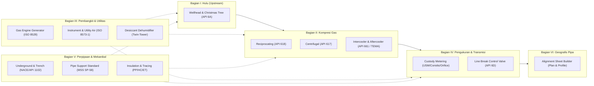
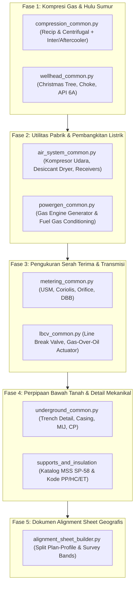

# Blueprint & Rencana Pengembangan Ekosistem AI-CAD Lanjutan: Hulu, Kompresi, Pembangkit, Utilitas, Transmisi & Perpipaan

**Dokumen No.**: `GPF-00-PM-PLN-0008`  
**Revisi**: `A2`  
**Tanggal**: `23 Oktober 2026`  
**Disiplin**: Upstream Facilities, Rotating Equipment, Power & Utilities, Pipeline & Piping Engineering  
**Standar Acuan**:
- **Hulu / Kepala Sumur**: API SPEC 6A / ISO 10423, API RP 14C
- **Kompresi & Pendingin**: API STD 618, API STD 617, API STD 661 / ISO 13706, TEMA Standards, ISO 13631
- **Pembangkitan Listrik**: ISO 3046, ISO 8528, NFPA 37, IEEE 141 / 242
- **Udara Tekan & Pengering**: ISO 8573-1, ISA-7.0.01, ASME Sec. VIII Div. 1
- **Transmisi & Pengukuran**: ASME B31.8, ASME B31.4, API 6D, API MPMS, AGA Report No. 3/7/9/11, ISO 5167, ISO 17089
- **Perpipaan Khusus, Insulasi & Support**: ASME B31.3, NACE SP0169, API RP 1102, MSS SP-58, ISO 12241, ASTM C585
- **Simbol & Drafting**: ANSI/ISA-5.1-2024, ISO 10628-2:2012, ISO 6412-2:2017, ISO 5457:1999, ISO 7200:2004

---

## 1. Pendahuluan & Visi Pengembangan

Ekosistem dasar AI-CAD perusahaan saat ini (`pid_common.py`, `plan_common.py`, `iso_common.py`, dan `validate_cad_rules.py`) telah stabil dan terbukti menghasilkan gambar fasilitas pemisahan separator dan pompa di atas tanah dengan zero defect.

Revisi **A2** ini merestrukturisasi rencana pengembangan lanjutan menjadi **6 Bagian Logis (Life-of-Field Sequence)**: mulai dari mulut sumur di hulu (*upstream*), pemampatan gas (*compression*), pembangkit daya & utilitas (*power & utilities*), sistem serah terima & pipa transmisi (*midstream/export*), detail perpipaan bawah tanah & mekanikal (*underground, support, & insulation*), hingga gambar bentang wilayah lintas negara (*cross-country alignment sheet*).



---

## Bagian I: Fasilitas Hulu & Kepala Sumur (`wellhead_common.py`)

Fasilitas hulu dimulai dari kepala sumur (*Surface Wellhead*) dan rangkaian katup kendali semburan sumur (*Christmas Tree*) sesuai **API SPEC 6A (ISO 10423)** dan sistem pengaman permukaan **API RP 14C**.

### 1.1 Arsitektur Blok Christmas Tree Standar (API 6A)
Christmas Tree digambar sebagai salib ortogonal vertikal-horizontal terflensa:

```text
               [TOP] Pressure Gauge (PI) & Bleeder Valve
                         │
                 [SWAB] Swab Valve (Gate Valve Manual)
                         │
             ┌───────────┴───────────┐
             │                       │
      [PROD WING]             [KILL WING]
   Hydraulic Gate Valve     Manual Gate Valve
             │                       │
      [PROD CHOKE]              [CHECK]
  Adjustable/Positive         Check Valve
             │                       │
      To Flowline / Header    From Kill Pump
             │
            [UMV] Upper Master Valve (Hydraulic Actuated / ESD)
             │
            [LMV] Lower Master Valve (Manual Gate Valve)
             │
      ================ Tubing Head Flange
             │
      [SCSSV / DHSV] Surface Controlled Sub-Surface Safety Valve
             │
       Deep in Wellbore
```

### 1.2 Katalog Komponen Kepala Sumur:
1. **Lower Master Valve (LMV)**: Gate valve manual 5000/10000 psi sebagai isolasi utama (selalu dibuka penuh saat produksi normal).
2. **Upper Master Valve (UMV)**: Gate valve otomatis dengan aktuator hidrolik bertekanan pegas (*fail-close spring-return*) yang terhubung ke logic solver ESD / panel darurat sumur.
3. **Production Wing Valve (PWV)**: Katup sayap produksi otomatis (aktuator hidrolik/pneumatik) untuk penghentian rutin sumur.
4. **Kill Wing Valve (KWV)**: Katup sayap manual untuk injeksi fluida berat pembunuh sumur (*kill fluid*) saat perawatan (*workover*).
5. **Choke Valve (Jepitan Sumur)**:
   - *Adjustable Choke*: Katup jarum berujung karbida tungsten dengan mikrometer pengatur laju alir dan penurun tekanan sumur.
   - *Positive Choke*: Rumah jepitan dengan lubang kacang (*choke bean*) tetap yang dapat diganti ukurannya.
6. **Swab Valve (Crown Valve)**: Katup gerbang manual di puncak pohon sumur untuk akses masuk kawat instrumen bawah sumur (*Wireline / Slickline Lubricator*).
7. **SCSSV Control Line**: Jalur sinyal hidrolik bertekanan tinggi ($3000 - 10000\text{ psi}$) dari panel kendali sumur ke katup pengaman bawah tanah (*Sub-Surface Safety Valve*).
8. **Annulus Outlets**: Titik pemantauan tekanan rongga cincin (*Casing Annulus A, B, C*) lengkap dengan katup jarum dan indikator tekanan (`PI`).

---

## Bagian II: Paket Kompresi Gas & Pendingin (`compression_common.py`)

Menangani kompresi gas bertingkat (*multi-stage compression*), pendinginan antar-tingkat (*intercooling*), pendinginan akhir (*aftercooling*), pemisahan kondensat, dan sistem proteksi anti-surge.

### 2.1 Kompresor Torak / Bolak-Balik (Reciprocating Compressor - API STD 618 / ISO 13631)
Digunakan untuk rasio tekanan tinggi, laju alir rendah-menengah, atau *gas lift / injection*:
1. **Silinder & Piston Assembly**:
   - Silinder kompresor ganda (*Double-Acting Cylinder*) dengan torak, batang piston (*piston rod*), silang kepala (*crosshead*), poros engkol (*crankshaft*), dan kotak engkol (*crankcase*).
   - Katup hisap dan tekan piringan otomatis (*automatic ring/plate valves*) dengan *valve unloader* untuk kendali kapasitas bertahap ($0\% - 50\% - 100\%$).
   - Penggerak (*Driver*): Motor listrik (`M`) atau Mesin Gas Torak (`GE`).
2. **Pulsation Dampener (Botol Pulsasi)**:
   - Bejana peredam getaran akustik fluida di nozzle hisap (*Suction Damper*) dan nozzle tekan (*Discharge Damper*) per API 618 Design Approach 3.
3. **Sistem Bantu Wajib**:
   - *Lube oil injection* bertekanan tinggi untuk pelumasan silinder dan *packing gland* dengan flow switch (`FSL`).
   - *Distance piece* dengan ventilasi uap bocor (*packing leakage purge*) ke sistem flare.

### 2.2 Kompresor Sentrifugal (Centrifugal Compressor - API STD 617)
Digunakan untuk pemampatan gas kapasitas besar atau transmisi pipa gas utama:
1. **Casing & Rotor**:
   - Casing tirus ISO 10628-2 (diameter suction besar, discharge mengecil) tipe *barrel (vertically split)* untuk tekanan tinggi atau *horizontally split* untuk tekanan menengah.
   - Poros rotor, bantalan luncur (*journal & thrust bearing*), dan sistem segel gas kering (*Dry Gas Seal - DGS*).
2. **Loop Proteksi Anti-Surge (Anti-Surge Control Loop - ISA-5.1)**:
   - **Anti-Surge Valve (ASV / FCV)**: Katup globe berkecepatan tinggi (*fast opening* $\le 1.0\text{ detik}$) dengan aktuator bervolume besar (*booster relay*).
   - Pengukuran komprehensif: Laju alir hisap (`FT`), tekanan hisap (`PT`), tekanan tekan (`PT`), dan temperatur (`TT`) yang diproses oleh *Anti-Surge Controller (UIC)* untuk membuka katup *recycle* kembali ke suction scrubber sebelum menyentuh batas garis *Surge Limit Line (SLL)*.

### 2.3 Sistem Pendingin: Intercooler & Aftercooler (API STD 661 & TEMA)
1. **Air-Cooled Heat Exchanger / Fin-Fan Cooler (API STD 661 / ISO 13706)**:
   - Baris berkas pipa bersirip (*finned tube bundle*) dengan motor kipas angin penginduksi/penekan (*induced/forced draft fan*).
   - Louver pengatur aliran udara otomatis (*auto-louver*) untuk menjaga kestabilan temperatur gas keluar (`TIC`).
2. **Shell & Tube Intercooler (TEMA)**:
   - Pilihan pendingin menggunakan media air pendingin sirkulasi (*Cooling Water*).
3. **Arsitektur Siklus Bertingkat (Multi-Stage Cycle)**:
   - **Tingkat 1**: Suction Scrubber 1 $\rightarrow$ Compressor Stage 1 $\rightarrow$ **Intercooler 1** $\rightarrow$ Suction Scrubber 2.
   - **Tingkat Akhir**: Final Stage Compressor $\rightarrow$ **Aftercooler** $\rightarrow$ Coalescing Filter Separator $\rightarrow$ Gas Export Pipeline.
   - Setiap scrubber antar-tingkat dilengkapi penampung cairan (*interstage drain*) dengan katup penguras otomatis level `LV`.

---

## Bagian III: Pembangkit Listrik & Sistem Utilitas Mandiri

### 3.1 Pembangkit Listrik Mesin Gas / Gas Engine Generator (`powergen_common.py`)
Pembangkit tenaga listrik mandiri di area terpencil memanfaatkan gas sumur hasil pemurnian:
1. **Modul Mesin Gas & Alternator (ISO 3046 & ISO 8528)**:
   - Blok mesin gas silinder-V atau inline (`GE`), kopling lentur, dan alternator AC 3-fasa (`G` $\sim$) di atas skid baja bersama (*common skid*) dengan peredam getaran pegas (*spring vibration dampers*).
2. **Sistem Pengondisian Gas Bahan Bakar (Fuel Gas Conditioning)**:
   - Gas dari separator $\rightarrow$ *Coalescing Filter* (pemisah kabut cairan) $\rightarrow$ *Preheater* (menaikkan suhu minimal $20^\circ\text{C}$ di atas titik embun gas) $\rightarrow$ Regulator tekanan ganda (*Dual Fuel Gas Regulator*) $\rightarrow$ Katup masuk mesin (*Carburetor / Gas Admission*).
3. **Sistem Pendingin Mesin**:
   - *Jacket Water (JW) Circuit*: Siklus air pendingin blok mesin dan kepala silinder ke radiator fin-fan.
   - *Auxiliary Water / Aftercooler Circuit (AW/AC)*: Siklus air pendingin turbocharger dan campuran udara-gas.
4. **Sistem Gas Buang (Exhaust System)**:
   - Sambungan muai fleksibel tahan panas (*Stainless Steel Bellows*) $\rightarrow$ Knalpot peredam suara (*Exhaust Silencer*) dengan penangkap percikan (*Spark Arrestor*) $\rightarrow$ Cerobong knalpot vertikal (*Exhaust Stack*) berpelindung hujan (*Rain Cap*).
5. **Antarmuka Kelistrikan**:
   - Saklar pemutus generator (*GCB*), transformator arus (`CT`), transformator tegangan (`PT`), dan panel bagi beban otomatis (*Auto-Synchronizing & Load Sharing*).

### 3.2 Sistem Udara Tekan, Instrumen & Dehumidifier (`air_system_common.py`)
Menyediakan pasokan udara bersih bertekanan untuk instrumen dan utilitas umum pabrik:
1. **Kompresor Udara Pabrik (Air Compressor Package)**:
   - *Rotary Screw Air Compressor* (Oil-Injected atau Oil-Free) dengan filter hisap udara atmosferik + motor listrik.
2. **Aftercooler & Wet Air Receiver**:
   - Pendingin udara keluar kompresor + pemisah air kondensat siklon otomatis (*Moisture Trap*).
   - Bejana udara basah vertikal (*Wet Air Receiver Tank*) ASME Sec. VIII dengan katup pengaman PSV dan auto-drain.
3. **Tahap Pra-Filtrasi (Pre-Filters)**:
   - *Coarse Particulate Filter* ($1 - 3\text{ mikron}$) + *Coalescing Oil Removal Filter* (kandungan oli $< 0.01\text{ mg/m}^3$).
4. **Dehumidifier Menara Kembar (Twin-Tower Desiccant Air Dryer)**:
   - Dua bejana vertikal berisi bahan pengering adsorpsi (*Activated Alumina / Molecular Sieve*).
   - Siklus operasi bergantian: **Menara A Mengeringkan (Drying)** sementara **Menara B Meregenerasi (Regenerating)** menggunakan tiupan udara kering (*Heatless Purge*) atau pemanas elektrik (*Heated Purge*).
   - Siklus pergantian katup pengalih diatur oleh timer PLC otomatis.
   - Pemancar kelembapan titik embun beku (*Dew Point Transmitter - AT / MT*) alarm basah (`MAH`) dengan target *Pressure Dew Point* $\le -40^\circ\text{C}$ (ISO 8573-1 Class 1.2.1 / ISA-7.0.01).
5. **Filter Pasca-Pengering (After-Filters)**:
   - *Particulate Dust Filter* ($0.01 - 1.0\text{ mikron}$) penangkap debu butiran desiccant.
6. **Dry Air Receiver & Katup Prioritas (Priority Valve)**:
   - Bejana udara kering (*Dry Instrument Air Receiver*) penahan pasokan minimum $15 - 30\text{ menit}$ saat kompresor padam.
   - **Katup Pengendali Tekanan Prioritas (Priority Sustaining Valve - PCV)**: Memisahkan jalur *Instrument Air (IA)* dan *Utility Air (UA)*. Jika tekanan sistem turun di bawah ambang aman ($5.5\text{ barg}$), katup otomatis menutup pasokan *Utility Air* agar sisa udara 100% dialokasikan untuk keselamatan operasi katup instrumen.

---

## Bagian IV: Sistem Pengukuran (Metering) & Katup Pipa Transmisi (LBCV)

### 4.1 Metering Station Suite (`metering_common.py`)
Sistem serah terima gas/minyak (*Custody Transfer & Allocation Metering*) dengan konfigurasi multi-run:
1. **Arsitektur Multi-Run**:
   - Header Masuk (*Inlet Header*) $\rightarrow$ $N$ Run Paralel (Duty / Standby) $\rightarrow$ Header Keluar (*Outlet Header*).
2. **Teknologi Metering Aliran (AGA & API MPMS)**:
   - **Ultrasonic Flow Meter (USM)** (AGA 9 / ISO 17089): Spool $10D-20D$ + *Flow Conditioner* (Zanker/tube bundle) + transduser multi-path akustik + *Flow Computer (FC/FQI)*.
   - **Coriolis Mass Meter** (AGA 11 / API MPMS 5.6): Tabung U-tube/lurus + pemancar massa/densitas (`FT/DT/TT`) + klem anti-vibrasi.
   - **Orifice Meter Run** (AGA 3 / ISO 5167): *Senior dual-chamber orifice fitting* (ganti piringan tanpa shutdown) + *corner/flange taps*.
   - **Turbine Flow Meter** (AGA 7 / API MPMS 5.3): Rotor bilah + pick-up coil + pelurus aliran hulu.
3. **Katup & Sistem Analisis Khusus**:
   - **Double Block & Bleed (DBB) Twin/Expanding Plug Valve**: Katup isolasi mutlak bebas rembes (*bubble-tight shut-off*) pada inlet & outlet setiap meter run dengan katup pembuang rongga (*cavity bleed valve*).
   - *Fast loop sampling probe* + *Gas Chromatograph (GC)* online analyzer untuk analisis fraksi C1–C6+, CO2, N2, dan Gross Heating Value.

### 4.2 LBCV / LBV Station Suite (Line Break Control Valve)
Katup pengaman pipa transmisi gas/minyak lintas negara (ASME B31.8 / API 6D):
1. **Main Line Valve (MLV)**:
   - *Full Bore Ball Valve* Trunnion Mounted API 6D (PIG-able) + *stem extension* $1.5-2.5\text{ m}$ jika badan katup ditanam di bawah tanah (*buried*).
2. **Sistem Aktuasi Otonom (Line Break Sensing)**:
   - **Gas-Over-Oil Actuator**: Akumulator gas bertekanan pipa yang menggerakkan hidrolik penutup katup secara mandiri tanpa sumber listrik eksternal (*fail-safe autonomous*).
   - **Line Break Pilot ($\Delta P / \Delta t$)**: Sensor laju penurunan tekanan pipa yang memicu penutupan katup seketika jika terjadi kebocoran pipa besar ($> 0.5\text{ bar/menit}$).
   - Pompa hidrolik manual darurat (*Emergency Hand Pump*) untuk membuka kembali katup setelah inspeksi pipa selesai.
3. **Pipa Bypass & Blowdown**:
   - Pipa *bypass equalizing* (DN50/DN80) penyeimbang tekanan hulu dan hilir sebelum katup utama dibuka.
   - Pipa cerobong buang vertikal (*Blowdown Stack*) ganda hulu & hilir lengkap dengan katup penutup ganda.

---

## Bagian V: Perpipaan Bawah Tanah, Tipe Support, & Insulasi

### 5.1 Piping Underground & Galian (`underground_common.py`)
1. **Layer & Gaya Garis**:
   - **`REF-PROC-UG`**: Garis putus-putus (*dashed*, $0.35\text{ mm}$).
   - Simbol **Soil-to-Air Interface**: Cincin sirip penahan rembesan (*puddle flange / water stop*) pada titik pipa keluar dari tanah.
2. **Generator Potongan Melintang Galian (Typical Trench Cross-Section)**:
   - Kedalaman galian (*cover depth* $\ge 1.0-1.2\text{ m}$ per ASME B31.8; $\ge 1.5\text{ m}$ pada penyeberangan jalan).
   - Bantalan pasir bawah (*sand bedding* $150\text{ mm}$) dan selimut pasir atas (*sand padding*).
   - Pita penanda bahaya (*Warning Tape*) $300 - 500\text{ mm}$ di bawah tanah.
   - Pemadatan urugan kembali ($95\%$ Standard Proctor).
3. **Proteksi Katodik & Penyeberangan (CP & Crossing)**:
   - **Monolithic Isolation Joint (MIJ)**: Sambungan isolasi tanpa flensa berkekuatan tinggi di batas tanah/udara pemutus arus proteksi katodik.
   - Tiang uji potensial tanah (*CP Test Post*).
   - Selubung pipa pelindung jalan/kereta (*Cased Road Crossing per API RP 1102*) lengkap dengan *casing spacers* plastik dan *end seals*.

### 5.2 Standardisasi Tipe Pipe Support (MSS SP-58 & ASME B31.3)
Katalog kode baku dan simbol 2D/isometrik:
| Kode Support | Tipe / Nama Standar | Fungsi / Derajat Kebebasan | Simbol Isometrik (ISO 6412-2) | Simbol Piping Plan 2D |
|---|---|---|---|---|
| **ANC** | **Anchor (Tumpuan Mati)** | Menahan translasi $X, Y, Z$ dan rotasi (kaku mutlak). | Kotak silang ganda `☒` dengan penopang kaku. | Kotak pejal dengan silang ganda `☒`. |
| **RES** | **Resting / Simple Shoe** | Menahan beban vertikal $(-Z)$; bebas ekspansi horizontal $(X, Y)$. | Garis tumpuan horizontal + kaki segitiga. | Garis pelat tumpu di bawah sumbu pipa. |
| **GUI** | **Guide (Pemandu Arah)** | Membatasi pipa agar hanya memuai aksial $(\pm X)$; menahan lateral $(\pm Y)$. | Tumpuan resting + sepasang garis pembatas lateral. | Tumpuan resting + dua sayap penjepit lateral. |
| **STP** | **Line Stop (Penahan Aksial)** | Menahan dorongan aksial memanjang $(\pm X)$; membiarkan lateral $(\pm Y)$. | Sepasang sirip pengganjal vertikal pada sepatu pipa. | Tumpuan resting + balok penahan aksial. |
| **HNG** | **Hanger (Gantungan Kaku)** | Menggantung pipa dari struktur atas menahan gravitasi $(-Z)$. | Batang vertikal dari klem pipa dengan loop engsel. | Lingkaran klem kecil + garis leader ke balok atas. |
| **VSP** | **Variable Spring Hanger** | Menahan pipa dengan gaya pegas variabel pada perpindahan termal sedang. | Tabung silinder dengan simbol kumparan pegas (*spring coil*). | Tabung lingkaran konsentris notasi "VS". |
| **CSP** | **Constant Spring Hanger** | Menahan pipa dengan gaya angkat konstan pada perpindahan termal kritis/besar. | Tabung silinder horizontal pegas lengan momen. | Tabung persegi panjang notasi "CS". |
| **TRN** | **Trunnion / Dummy Support** | Pipa stub palsu yang dilas ke siku pipa (*elbow*) menopang ke struktur. | Garis pipa buntu terputus tepat di punggung siku pipa. | Proyeksi pipa vertikal di bawah siku. |

- **Standar Tinggi Sepatu Pipa (Shoe Height - SH)**: $SH = 0\text{ mm}$ (bare/pad), $100\text{ mm}$ (insulasi $\le 50\text{ mm}$), $150\text{ mm}$ (insulasi $60-100\text{ mm}$), dan $200\text{ mm}$ (insulasi $> 100\text{ mm}$).

### 5.3 Standardisasi Insulasi & Heat Tracing (P&ID & Piping)
- **Kode Kelas Insulasi**: **`PP`** (Personnel Protection), **`HC`** (Heat Conservation), **`CC`** (Cold Conservation), **`AC`** (Acoustic), **`ET`** (Electric Tracing), dan **`ST`** (Steam Tracing).
- **Simbol P&ID**: Garis selubung ganda + label `[PP-50]` atau `[ET-HC-40]`.
- **Isometrik**: Garis rantai batas insulasi + hitung otomatis $m^2$ insulasi & $m$ kabel tracing pada BOM.
- **Piping Plan**: Penjagaan jarak renggang bersih antar-pipa (*clearance*) minimum $100\text{ mm}$ dari kulit terluar cladding insulasi.

---

## Bagian VI: Pembuat Pipeline Alignment Sheet (`alignment_sheet_builder.py`)

Memadukan data survei topografi GIS dengan gambar teknik pipa transmisi bentang panjang:
1. **Tata Letak Lembar Split-Window A1**:
   - **Panel Atas (40%)**: *Plan View* (Sumbu pipa KP, batas ROW $15-25\text{ m}$, tikungan cold/hot bend, penyeberangan jalan/sungai/fasilitas lain).
   - **Panel Tengah (30%)**: *Profile View* (Skala vertikal berlebih, kontur tanah asli NGL, elevasi dasar pipa BOP, profil galian terbuka vs HDD).
   - **Panel Bawah (30%)**: *Data Bands* berjejer vertikal per stasiun KP (Ground Elev, Pipe Elev, Depth of Cover, Chainage KP, Wall Thickness & Grade API 5L, Class Location ASME B31.8, Coating 3LPE/Concrete, dan Klasifikasi Tanah).
2. **Parser Data Survei**:
   - Otomatis membaca file data survei tabel (*CSV / Excel*) stasiun KP, Northing, Easting, dan Elevasi untuk membangkitkan garis sumbu dan penampang profil secara terpadu.

---

## Roadmap Implementasi Bertahap



Dokumen perancangan teknis Rev A2 ini telah dirapikan secara terstruktur, komprehensif, dan siap dipublikasikan ke repositori GitHub.

---

## Status Implementasi (23 Oktober 2026)

Kesembilan modul roadmap ini **TERIMPLEMENTASI PENUH** (Fase 1–5) oleh
subagent GLM-5.3-Flash paralel, diverifikasi PM (linter 0 error + QA visual
independen), dan terinstal di skill perusahaan. Detail eksekusi dan temuan:
lihat review log `GPF-00-QA-0004` Round **ROADMAP-08**.

| Modul (fase) | File pustaka | Demo drawing (Rev A0) | Status |
|---|---|---|---|
| wellhead_common (F1) | `cad/wellhead_common.py` | GPF-00-PI-PID-0011 | LULUS linter+visual |
| compression_common (F1) | `cad/compression_common.py` | GPF-00-PI-PID-0012 | LULUS linter+visual |
| air_system_common (F2) | `cad/air_system_common.py` | GPF-00-PI-PID-0014 | LULUS linter+visual |
| powergen_common (F2) | `cad/powergen_common.py` | GPF-00-PI-PID-0013 | LULUS linter+visual |
| metering_common (F3) | `cad/metering_common.py` | GPF-00-PI-PID-0015 | LULUS linter+visual |
| lbcv_common (F3) | `cad/lbcv_common.py` | GPF-00-PI-PID-0016 | LULUS linter+visual |
| underground_common (F4) | `cad/underground_common.py` | GPF-00-PI-PLN-0017 | LULUS linter+visual |
| supports_and_insulation (F4) | `cad/supports_insulation_common.py` | GPF-00-PI-STD-0018 | LULUS linter+visual |
| alignment_sheet_builder (F5) | `cad/alignment_sheet_builder.py` | GPF-00-PI-PLN-0019 | LULUS linter+visual |

Salinan pustaka terpasang di `skills/company-cad-standard/scripts/` +
`~/skills-patches/` + `~/.agents/skills/` (via `reapply.sh`); katalog
didokumentasikan di `SKILL.md` §6C. Tindak lanjut terbuka untuk B0: registrasi
nomor line modul baru ke line index, upgrade `apply_text.py` (layer
REF-PROC-UG), dan penguatan Check 5 linter (teks vs REF-SIG/REF-FRAME).
