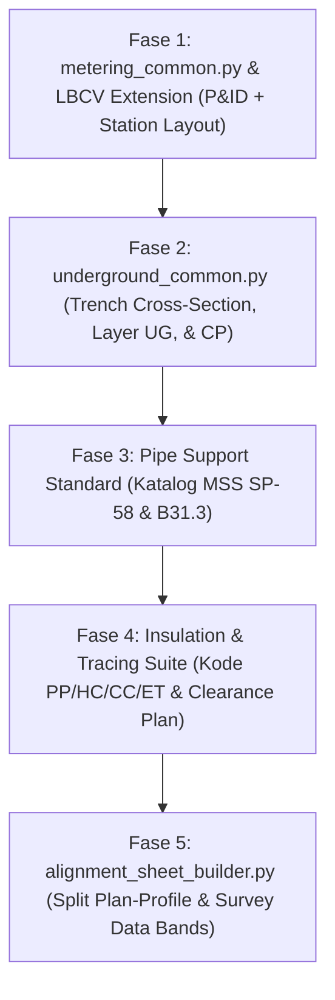

# Blueprint & Rencana Pengembangan Ekosistem AI-CAD Lanjutan: Pipeline, Metering, LBCV, Underground, Insulasi, & Pipe Support

**Dokumen No.**: `GPF-00-PM-PLN-0008`  
**Revisi**: `A0`  
**Tanggal**: `23 Oktober 2026`  
**Disiplin**: Pipeline Engineering, Process/Facilities, Piping & Mechanical  
**Standar Acuan Utama**:
- **Pipeline & Piping**: ASME B31.8 (Gas Transmission), ASME B31.4 (Liquid Pipeline), ASME B31.3 (Process Piping), API 6D (Pipeline Valves), API 5L (Line Pipe)
- **Metering**: API MPMS (Manual of Petroleum Measurement Standards), AGA Report No. 3 (Orifice), No. 7 (Turbine), No. 9 (Ultrasonic), No. 11 (Coriolis), ISO 5167, ISO 17089
- **Insulasi & Perlindungan**: ISO 12241, ASTM C585, C591, C547, C534, PIP INEG1000 / INSC1000
- **Pipe Support**: MSS SP-58 (Materials, Design, Manufacture, Selection, Application, and Installation), MSS SP-69, ASME B31.3 Appendix X
- **Piping Underground & CP**: NACE SP0169 / ISO 15589-1 (Cathodic Protection), API RP 1102 (Steel Pipelines Crossing Railroads and Highways)
- **Dokumentasi & Simbol**: ANSI/ISA-5.1-2024, ISO 10628-2:2012, ISO 6412-2:2017, ISO 5457:1999, ISO 7200:2004

---

## 1. Pendahuluan & Sasaran Pengembangan
Modul dasar AI-CAD yang telah kita bangun (`pid_common.py`, `plan_common.py`, `iso_common.py`, dan `validate_cad_rules.py`) telah berhasil membuktikan pembuatan gambar bejana proses, pompa, dan perpipaan skid di atas tanah (*aboveground*) dengan presisi 100% dan zero defect.

Rencana pengembangan ini mendetailkan spesifikasi teknis dan konsep arsitektur untuk memperluas kemampuan AI-CAD perusahaan ke ranah **Pipeline Engineering, Metering System, Katup Pengaman Transmisi (LBCV), Perpipaan Bawah Tanah (Underground), Sistem Insulasi Termal/Akustik, serta Standardisasi Tipe Pipe Support** sebelum tahap penulisan kode dimulai.

---

## 2. Fitur Modul 1: Metering Station Suite (`metering_common.py` & P&ID Extension)

Sistem serah terima gas/minyak (*Custody Transfer & Allocation Metering*) memiliki aturan ketat terkait konfigurasi hulu/hilir (*upstream/downstream meter tube*) dan isolasi tanpa kebocoran.

### 2.1 Arsitektur Sistem Multi-Run Metering (Duty / Standby)
Setiap stasiun metering dirancang memiliki header masuk (*Inlet Header*), $N$ unit *meter run* paralel (misal 2×100% atau 3×50%), dan header keluar (*Outlet Header*).

### 2.2 Teknologi Metering Parametrik (ISO 10628-2, AGA & API MPMS)
1. **Ultrasonic Flow Meter (USM) Run (AGA Report No. 9 / ISO 17089)**:
   - Spool hulu ($10D - 20D$) dilengkapi *Flow Conditioner Flange* (tipe Zanker atau 19-tube bundle).
   - Bodi spool meter USM dengan sepasang transduser akustik multi-path ($4 - 8$ path diagonal).
   - Spool hilir ($5D$) dilengkapi *Thermowell* (`TW`) dan *Pressure Tap* (`PT`) di hilir meter agar tidak mengganggu profil kecepatan aliran.
   - Flow Computer (`FC / FQI`) multi-channel di DCS / Panel Kontrol.
2. **Coriolis Mass Flow Meter Run (AGA Report No. 11 / API MPMS Ch. 5.6)**:
   - Simbol bodi tabung Coriolis (pilihan tipe *bent-tube* / U-tube atau *straight-tube*).
   - Pemancar densitas, temperatur, dan massa terintegrasi (`FT / DT / TT`).
   - Tidak memerlukan *straight run* hulu sepanjang USM, namun memerlukan penopang anti-vibrasi (*rigid base clamp*).
3. **Orifice Meter Run (AGA Report No. 3 / ISO 5167-2)**:
   - *Senior Orifice Fitting* (dual-chamber orifice fitting yang dapat mengganti piringan orifice saat pipa bertekanan tanpa shutdown) atau *Orifice Flange Union*.
   - Pasangan tap sudut (*corner taps*) atau tap flensa (*flange taps* $25.4\text{ mm}$ hulu/hilir).
4. **Turbine Flow Meter (AGA Report No. 7 / API MPMS Ch. 5.3)**:
   - Rotor blade + pick-up coil magnetik + *straightening vanes* hulu.

### 2.3 Katup Khusus & Perlengkapan Metering Run
- **Double Block & Bleed (DBB) Twin/Expanding Plug Valve**: Katup masuk dan keluar setiap meter run untuk memastikan isolasi 100% bebas rembes (*bubble-tight positive shut-off*) saat kalibrasi run standby. Dilengkapi katup pembuang manual (*cavity bleed valve*) di antara dua dudukan.
- **Fast Loop Sampling System & Gas Chromatograph (GC)**: Sampling probe yang menjorok ke 1/3 diameter pipa + fast loop regulator + sample conditioning system + analyzer GC (`AT-xxx`) untuk analisis komposisi gas (C1–C6+, CO2, N2, Gross Heating Value).

---

## 3. Fitur Modul 2: LBCV / LBV Station Suite (Line Break Control Valve)

Katup pengaman pipa transmisi lintas negara (*cross-country pipeline*) sesuai **ASME B31.8 / API 6D** yang berfungsi menutup secara otomatis saat terjadi patahan pipa (*line break*).

### 3.1 Skema P&ID & Station Piping Layout
1. **Main Line Valve (MLV)**:
   - *Full Bore Ball Valve* (Trunnion Mounted API 6D) dengan ukuran lubang penuh (*full bore*) agar dapat dilewati *intelligent inspection pig* (PIG-able).
   - *Stem Extension*: Batang katup diperpanjang $1.5 - 2.5\text{ m}$ ke atas tanah jika badan katup ditanam (*buried*).
2. **Sistem Aktuasi Line Break**:
   - **Gas-Over-Oil Actuator**: Tangki akumulator gas bertekanan pipa yang menggerakkan silinder oli hidrolik untuk memutar aktuator *quarter-turn*.
   - **Line Break Sensing Pilot ($\Delta P / \Delta t$)**: Sensor pneumatik/mekanikal laju penurunan tekanan. Jika tekanan pipa anjlok melebihi batas laju ambang (misal $> 0.5\text{ bar/menit}$), katup tertutup otomatis tanpa memerlukan suplai listrik eksternal (*fail-safe autonomous*).
   - **Manual Emergency Hand Pump**: Pompa hidrolik manual untuk membuka kembali katup setelah perbaikan.
3. **Rangkaian Bypass & Blowdown**:
   - Pipa *bypass equalizing* (DN50/DN80) dengan 2 gate/ball valve manual untuk menyeimbangkan tekanan hulu dan hilir sebelum membuka katup utama.
   - Pipa *blowdown stack* vertikal hulu dan hilir lengkap dengan katup isolasi ganda untuk pengosongan gas pipa saat perbaikan darurat.

---

## 4. Fitur Modul 3: Piping Underground & Galian (BOH, Trench, & CP)

Perpipaan bawah tanah memiliki kaidah visual dan teknis yang sangat berbeda dengan perpipaan atas tanah.

### 4.1 Layering & Garis CAD
- **Layer `REF-PROC-UG`**: Garis putus-putus (*dashed/hidden*) dengan bobot `0.35 mm` untuk membedakannya secara visual dari pipa atas tanah (`REF-PROC` *continuous* `0.50 mm`).
- **Simbol Soil-to-Air Interface**: Simbol penanda titik transisi dari tanah ke udara (penetrasi lantai beton / permukaan tanah) berupa pelat cincin sirip air (*water stop flange / puddle flange*).

### 4.2 Generator Potongan Melintang Galian (Trench Cross-Section)
Modul detail galian tipikal (*Typical Trench Detail*) parametrik:
1. Kedalaman penanaman (*Depth of Cover / BOH - Bottom of Hole*):
   - Standar terbuka: minimum $1.0\text{ m}$ di atas pipa (ASME B31.8).
   - Penyeberangan jalan/saluran air: minimum $1.2 - 1.5\text{ m}$.
2. Lapisan galian berlapis:
   - Dasar galian (*trench bottom*) dipadatkan.
   - Lapisan bantalan pasir halus (*sand bedding*) tebal $150\text{ mm}$ di bawah pipa.
   - Lapisan selimut pasir (*sand padding*) tebal $150 - 300\text{ mm}$ di sekeliling dan atas pipa.
   - Pita penanda bahaya (*Warning Tape / Marker Mesh*) berwarna kuning terang diletakkan $300 - 500\text{ mm}$ di bawah permukaan tanah.
   - Urugan tanah kembali (*backfill soil*) dipadatkan bertahap ($95\%$ Standard Proctor).

### 4.3 Proteksi Katodik & Penyeberangan (CP & Crossing)
- **Monolithic Isolation Joint (MIJ)**: Sambungan isolasi tanpa flensa berkekuatan tinggi di batas antara area bawah tanah dan atas tanah (*Aboveground/Underground boundary*) untuk memutus kesinambungan listrik proteksi katodik.
- **Cathodic Protection Test Post (CP Station)**: Tiang uji potensial tanah-ke-pipa yang dipasang setiap $1\text{ km}$ atau di penyeberangan jalan.
- **Cased Road/Rail Crossing Detail (API RP 1102)**: Selubung pipa baja pelindung luar (*carrier pipe inside casing pipe*), dilengkapi *insulating casing spacers* plastik setiap $2\text{ m}$ dan *casing end seals* di kedua ujungnya.

---

## 5. Fitur Modul 4: Standardisasi Tipe Pipe Support (MSS SP-58 & ASME B31.3)

Untuk melengkapi modul Isometrik dan Piping Plan, simbol *support* tidak boleh hanya berupa tulisan teks bebas, melainkan wajib memiliki kode baku dan simbol grafis 2D/isometrik yang seragam.

### 5.1 Katalog Kode & Fungsi Support Perusahaan (Baku)
| Kode Support | Tipe / Nama Standar | Fungsi / Derajat Kebebasan | Simbol Isometrik (ISO 6412-2) | Simbol Piping Plan 2D |
|---|---|---|---|---|
| **ANC** | **Anchor (Tumpuan Mati)** | Menahan translasi $X, Y, Z$ dan rotasi (kaku mutlak, membagi sistem tegangan pipa). | Kotak silang ganda penuh `☒` dengan tanda segitiga kaku ke lantai. | Kotak pejal dengan silang ganda `☒` di kedua sisi pipa. |
| **RES** | **Resting / Simple Shoe** | Menahan beban vertikal gravitasi $(-Z)$; bebas memuai horizontal $(X, Y)$ dan terangkat $(+Z)$. | Garis tumpuan horizontal di bawah pipa + kaki segitiga terbuka. | Garis pelat tumpu persegi panjang di bawah sumbu pipa. |
| **GUI** | **Guide (Pemandu Arah)** | Menahan translasi tegak lurus sumbu pipa $(\pm Y)$; membatasi pipa agar hanya memuai sejajar sumbu pipa $(\pm X)$. | Tumpuan resting + sepasang garis pembatas lateral kiri/kanan. | Tumpuan resting + dua garis sayap penjepit lateral. |
| **STP** | **Line Stop (Penahan Aksial)** | Menahan pergerakan aksial memanjang $(\pm X)$; membiarkan pemuaian lateral $(\pm Y)$. | Sepasang sirip pengganjal vertikal tegak lurus pipa pada sepatu pipa (*pipe shoe*). | Tumpuan resting + balok penahan aksial di depan/belakang shoe. |
| **HNG** | **Hanger (Gantungan Kaku)** | Menggantung pipa dari struktur atas; menahan beban gravitasi bawah $(-Z)$. | Batang garis vertikal ke atas dari klem pipa dengan loop engsel atas. | Lingkaran klem kecil dengan garis leader ke balok profil atas. |
| **VSP** | **Variable Spring Hanger** | Menahan pipa yang mengalami perpindahan vertikal termal termoderasi dengan gaya pegas variabel. | Silinder tabung pegas dengan simbol kumparan zig-zag (*spring coil*). | Tabung lingkaran konsentris bertuliskan "VS" + klem. |
| **CSP** | **Constant Spring Hanger** | Menahan pipa dengan gaya angkat konstan pada titik dengan pemuaian vertikal termal kritis/besar. | Tabung silinder horizontal pegas lengan momen + penunjuk beban. | Tabung persegi panjang dengan notasi "CS". |
| **TRN** | **Trunnion / Dummy Support** | Pipa stub vertikal palsu yang dilas ke siku pipa (*elbow*) untuk menopang pipa ke lantai/struktur. | Garis pipa buntu terputus ke lantai tepat di punggung siku pipa. | Garis proyeksi pipa vertikal di bawah siku. |

### 5.2 Standar Dimensi Ketinggian Sepatu Pipa (Pipe Shoe Heights)
Tinggi sepatu pipa (*Shoe Height - SH*) distandarkan terhadap tebal insulasi:
- **Tipe Non-Insulasi**: $SH = 0\text{ mm}$ (pipa menempel langsung di bantalan pelindung *wear pad*).
- **Tipe Bare / Ringan**: $SH = 50\text{ mm}$ atau $100\text{ mm}$.
- **Tipe Insulasi Standar**: $SH = 100\text{ mm}$ (untuk tebal insulasi $\le 50\text{ mm}$).
- **Tipe Insulasi Tebal**: $SH = 150\text{ mm}$ (untuk tebal insulasi $60 - 100\text{ mm}$).
- **Tipe Insulasi Ekstra**: $SH = 200\text{ mm}$ (untuk tebal insulasi $> 100\text{ mm}$).

---

## 6. Fitur Modul 5: Standardisasi Sistem Insulasi & Tracing (P&ID & Piping)

Insulasi wajib tercatat konsisten dari gambar P&ID, Piping Plan, hingga Isometric BOM.

### 6.1 Kode Kelas Insulasi (Company Piping Line Class)
| Kode Insulasi | Tujuan / Deskripsi Servis | Material Standar | Lapisan Pelindung (Cladding) |
|---|---|---|---|
| **PP** | **Personnel Protection** (Mencegah luka bakar personel, $T_{\text{oper}} > 60^\circ\text{C}$). | Mineral Wool / Rockwool blanket | Alumunium 0.6 mm roll-jacketing |
| **HC** | **Heat Conservation** (Menjaga panas proses / konservasi energi). | Calcium Silicate / Rockwool preformed | Alumunium 0.8 mm jacketing |
| **CC** | **Cold Conservation** (Mencegah kehilangan dingin & kondensasi, $T < 10^\circ\text{C}$). | Cellular Glass (Foamglas) / PIR | Stainless Steel 0.5 mm / Alumunium |
| **AC** | **Acoustic Insulation** (Peredam kebisingan dari katup kontrol / kompresor, $> 85\text{ dBA}$). | High-density Rockwool + Mass Barrier (Loaded Vinyl) | Perforated / Solid Alumunium |
| **ET** | **Electrical Heat Tracing** (Pemanas kabel listrik anti-beku / penjaga viskositas minyak mentah). | Self-regulating heating cable | Alumunium foil wrap + jacketing |
| **ST** | **Steam Tracing** (Pipa pipa tembaga kecil pemanas uap). | 1/2" Copper/SS tubing + heat transfer mastic | Cladding terpadu dengan pipa utama |

### 6.2 Representasi Simbolis Insulasi pada Drawing
1. **Pada P&ID (ANSI/ISA-5.1)**:
   - Garis tebal pendek paralel (*double line sleeve*) di sekitar pipa atau simbol `spec_break` bertuliskan kode dan tebal insulasi: contoh `[PP-50]` (Personnel Protection tebal 50 mm) atau `[ET-HC-40]` (Heat Tracing + Heat Conservation tebal 40 mm).
2. **Pada Isometrik (ISO 6412-2)**:
   - Garis batas insulasi berupa garis rantai putus-titik-titik ganda di sepanjang segmen pipa berinsulasi.
   - Pengecualian flange/valve yang tidak berinsulasi (*uninsulated flange cap*).
   - Tabel BOM otomatis mencatat kuantitas luas meter persegi ($m^2$) insulasi dan meter panjang ($m$) kabel heat tracing.
3. **Pada Piping Plan**:
   - Pipa tetap single line, namun *outer envelope* (diameter luar insulasi $OD_{\text{total}} = OD_{\text{pipe}} + 2 \times \text{Thickness}$) diperhitungkan pada jarak renggang bebas antar pipa (*Pipe-to-Pipe Clearance*) minimal $100\text{ mm}$ antar cladding terluar.

---

## 7. Fitur Modul 6: Pipeline Alignment Sheet Suite (`alignment_sheet_builder.py`)

Alignment Sheet adalah jenis gambar khusus yang memadukan data survei topografi GIS dengan perancangan mekanikal pipa.

### 7.1 Pembagian Tata Letak Lembar (Split-Window Standard ISO A1)
Lembar A1 horizontal dibagi menjadi 3 zona kerja proporsional:
1. **Zona 1 (Atas, Tinggi 40% Lembar): Plan View (Tampak Atas Rute)**:
   - Garis sumbu rute pipa (*Centerline*) dari kiri (hulu, misal KP 10+000) ke kanan (hilir, misal KP 12+500).
   - Batas *Right of Way* (ROW) selebar $15 - 25\text{ m}$ di kiri dan kanan pipa.
   - Fitur geografis: jalan raya, rel kereta api, sungai, batas desa/kecamatan, dan utilitas eksisting.
   - Lokasi tikungan pipa: *Point of Intersection (PI)*, sudut defleksi tikungan (*Deflection Angle*), dan tipe tikungan (*Cold Field Bend* radius $R \ge 40D$ atau *Hot Induction Bend* $3D / 5D$).
2. **Zona 2 (Tengah, Tinggi 30% Lembar): Profile View (Potongan Profil Memanjang)**:
   - Skala vertikal berlebih (*exaggerated vertical scale*, misal 1:200 vertikal vs 1:2000 horizontal) agar perbedaan elevasi tanah terlihat tajam.
   - Garis kontur tanah asli (*Natural Ground Level - NGL*).
   - Garis profil dasar pipa (*Top of Pipe - TOP* dan *Bottom of Pipe - BOP*).
   - Profil penyeberangan khusus galian terbuka (*Open Cut*) vs pengeboran berarah horizontal (*Horizontal Directional Drilling - HDD*).
3. **Zona 3 (Bawah, Tinggi 30% Lembar): Engineering Data Bands (Tabel Jalur Berjejer)**:
   - Jalur kolom data sinkron tepat vertikal di bawah setiap stasiun KP:
     - **Band 1: Ground Elevation** (m DPL).
     - **Band 2: Pipe Elevation** (m DPL).
     - **Band 3: Depth of Cover** (m).
     - **Band 4: Stationing Chainage** (KP km + m).
     - **Band 5: Pipe Wall Thickness & Grade** (misal $WT = 9.53\text{ mm}$, API 5L X-65 PSL2).
     - **Band 6: Design Factor & Class Location** (ASME B31.8 Class 1 Div 2, $F = 0.72$ vs Class 3, $F = 0.50$).
     - **Band 7: Coating Type** (3LPE tebal $3.0\text{ mm}$ / Concrete Weight Coating $50\text{ mm}$).
     - **Band 8: Terrain & Soil Classification** (Tanah Liat, Pasir, Rawa, Batuan Keras).

---

## 8. Urutan Rencana Implementasi (Next Action Roadmap)

Untuk merealisasikan arsitektur ini secara bertahap dan teruji tanpa menimbulkan regresi pada sistem yang sudah stabil:

Rencana konsep ini telah disusun lengkap dan siap dipublikasikan ke repositori GitHub Anda.
