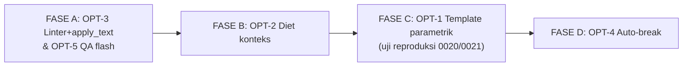

# Rencana Optimasi Tooling AI-CAD: Template Parametrik, Penguatan Linter, Diet Konteks & QA Efisien

**Dokumen No.**: `GPF-00-PM-PLN-0009`
**Revisi**: `A0`
**Tanggal**: `26 Oktober 2026`
**Disiplin**: AI-CAD Tooling Engineering
**Baseline**: hasil pengukuran riil 23–26 Okt 2026 (roadmap GPF-00-PM-PLN-0008 + uji 2 P&ID stasiun kompresi PID-0020/0021)

---

## 1. Pendahuluan & Baseline Terukur

Tooling AI-CAD perusahaan telah terbukti menghasilkan gambar zero-defect (11
lembar baru dalam 3 hari, semua lulus `validate_cad_rules.py` exit 0 + QA
visual). Namun pengukuran riil menunjukkan biaya per lembar masih tinggi dan
hilang di 3 tempat: (a) fase baca konteks subagent sebelum menulis kode,
(b) penulisan script gambar 600–900 baris yang 80%-nya struktur berulang,
(c) iterasi perbaikan linter/visual.

### 1.1 Baseline per lembar (subagent GLM-5.3-Flash, jurnal workflow)

| Pekerjaan | Token | Waktu dinding | Iterasi | Tool calls |
|---|---|---|---|---|
| P&ID stasiun kompresi baru (PID-0020, recip 2×50%) | 12,2 jt | 63 mnt | 3 | 56 |
| P&ID stasiun kompresi baru (PID-0021, centrifugal 2×50%) | 22,6 jt | 82 mnt | 3 | 82 |
| Modul pustaka + demo (9 modul roadmap, rentang) | 6–21,7 jt | 40–90 mnt | 3–5 | 51–96 |
| QA visual independen (per batch 4–6 lembar) | 0,8–3,0 jt | 16–22 mnt | 1 | 4–51 |

### 1.2 Diagnosa pembagian waktu (observasional, PID-0020/0021)

1. **±20–35%**: membaca AGENTS.md + SKILL.md penuh (termasuk seksi tidak
   relevan untuk tugas, mis. aturan isometrik §7 saat menggambar P&ID) +
   source `pid_common.py` (~1.500 baris) + pustaka modul.
2. **±40–50%**: menulis script lembar — padahal struktur (header, scrubber,
   kompresor, cooler, BD, ESD, furniture A1) identik antar-lembar sejenis.
3. **±20–30%**: iterasi — 2–3 ronde dipicu linter (gap break manual,
   tabrakan teks) + 1–2 ronde dipicu QA visual (temuan kelas yang LINTER
   LEPASKAN, lihat OPT-3).

**Prinsip**: mahalnya bukan di runtime Python (build ±0,5 s) melainkan di
AI menulis script — maka semua optimasi diarahkan mengecilkan porsi itu.

---

## 2. OPT-1 — Template Parametrik Stasiun (DAMPAK TERBESAR)

### 2.1 Konsep

Mengubah pembuatan lembar sejenis dari *"AI menulis script"* menjadi *"AI
mengisi config"*. Dibangun `cad/pid_station_template.py` yang membaca config
JSON dan membangkitkan lembar via pustaka yang ada (`pid_common` +
`compression_common`; kemudian diperluas ke modul lain). **DILARANG**
resize/Stretch DXF harfiah — template menghasilkan geometri baru dari
parameter (keputusan desain yang sudah diambil sebelumnya).

### 2.2 Skema config JSON (v1, kasus kompresi)

```json
{
  "doc_no": "GPF-00-PI-PID-0022",
  "title": "GAS BOOSTER COMPRESSION - RECIPROCATING",
  "package": "compression",
  "compressor": {"type": "recip", "stages": 1, "driver": "motor",
                 "unloader": "0-50-100"},
  "trains": 2, "duty": "50%",
  "battery_limits": {"inlet": "FROM FIELD GAS SUPPLY",
                     "outlet": "TO SALES PIPELINE",
                     "flare": "TO FLARE KO DRUM"},
  "conditions": {"p_suction_psig": 250, "p_discharge_psig": 450,
                 "flow_mmscfd": 10, "t_suction_c": 40},
  "line_prefix": "NG", "line_series": 9000,
  "size_suction": 150, "size_discharge": 100, "size_bd": 80,
  "cooler": {"type": "finfan", "tic_autolouver": true},
  "extras": {"recip": ["pulsation_dampeners", "spillback",
                       "lube_oil", "distance_piece_purge"],
             "centrifugal": ["antisurge_loop", "coalescer", "dgs"]},
  "furniture": {"notes_extra": [], "rev": "A0", "date": "26 OCT 2026"}
}
```

### 2.3 Cakupan & keluaran

1. Layout generator: N train paralel (1–3) band atas/bawah, header
   hisap/tekan kiri-kanan, BD header bawah, furniture kolom kanan
   (NOTES/LEGEND/REF/REV/TITLE) — pola PID-0020/0021.
2. Penomoran otomatis: line (prefix+series+posisi), equipment (suffix
   A/B/C), instrumen (loop per train), PSV/BDV/SDV — dari satu sumber
   config, mustahil inkonsisten.
3. Keluaran mengikuti rantai QA penuh yang sama: build → `apply_text.py`
   → linter → snapshot → visual. Template TIDAK mem-bypass QA.
4. Jalur keluar (escape hatch): template adalah jalur CEPAT, bukan
   satu-satunya — script manual tetap sah untuk kasus tak terdefinisi.

### 2.4 Uji penerimaan (acceptance test)

- Reproduksi PID-0020 & PID-0021 sebagai config: linter exit 0, konten
  fitur utama setara (scrubber/dampener/ASV/spill-back/fin-fan/BD/ESD),
  QA visual PASS.
- Lembar baru dengan parameter berbeda (mis. 3×50%, 300→600 psig) dari
  config menghasilkan keluaran valid tanpa penyuntingan template.
- **Target KPI**: lembar stasiun baru = **< 10 menit dinding & < 1,5 jt
  token total** (authoring config + build + QA), iterasi visual ≤ 1.

---

## 3. OPT-2 — Diet Konteks Subagent

### 3.1 Masalah

Tiap subagent membaca ulang: AGENTS.md penuh, SKILL.md penuh (termasuk §7
isometrik yang tak relevan untuk P&ID), source pustaka utuh. Terukur
sebagai fase baca 15–30 menit pertama + porsi besar token.

### 3.2 Solusi

1. `references/api-cheatsheet.md` baru di skill: 1 file ringkas (target
   ≤ 300 baris) berisi daftar fungsi seluruh pustaka — nama, signature,
   1 baris deskripsi — dikelompokkan per konteks (P&ID / plan / iso /
   modul lanjutan). Digenerate dari docstring pustaka (script kecil) agar
   tak basi saat API berubah. Subagent membaca cheatsheet, membuka source
   hanya fungsi yang dipakai.
2. Brief tugas bertingkat: untuk tugas P&ID cukup muat §1–§6+§8 SKILL
   (lewati §6B/§7); sediakan 3 varian brief (pid/plan/iso) sebagai
   templat prompt PM.
3. Manifest pola: contoh config/demo minimal sebagai acuan (lihat OPT-1).

### 3.3 Uji penerimaan & target

- Subagent tugas P&ID baru menyelesaikan tanpa membaca §7/§6B.
- **Target KPI**: token per builder script-manual turun **30–50%**
  (12–22 jt → 6–12 jt); fase baca < 10 menit.

---

## 4. OPT-3 — Penguatan Linter (Geser QA dari Mata ke Mesin)

### 4.1 Celah yang terbukti lolos (ditemukan QA visual, tidak linter)

| No | Celah | Bukti (23–26 Okt) | Perbaikan |
|---|---|---|---|
| 1 | Check 5 hanya uji teks vs REF-PROC/EQUIP — **teks vs REF-SIG/REF-FRAME/REF-GRID tidak dicek** | sinyal pilot menembus label aktuator (lbcv); ground line menembus 'ANNULUS C' (wellhead) | perluas himpunan layer yang diperiksa Check 5 |
| 2 | Faktor lebar karakter 0,62×h — **Arial asri ±0,73×h** | teks NOTES meluber border kolom (underground); label menimpa flange (air_system) | naikkan faktor ke 0,73 (atau ukur per-string: `len(t)*0.73*h`) di validator & `apply_text` guard |
| 3 | **REF-PROC-UG tidak diperiksa** Check 4/5/6 | rute bawah tanah hanya diverifikasi manual | tambahkan REF-PROC-UG ke himpunan layer check |
| 4 | `apply_text.py` tak mengenal pens REF-PROC-UG | workaround `stamp_layer_pens()` di pustaka | daftarkan REF-PROC-UG = 0,35 di tabel pens `apply_text.py`; hapus workaround setelahnya |

### 4.2 Uji penerimaan & target

- Kasus-kasus bukti di atas (simpan sebagai DXF regresi mini) DITANGKAP
  linter (exit 1) — negative test di `test_validate_cad_rules.py`.
- **Target KPI**: rata-rata iterasi per lembar 3 → **≤ 2**; kelas temuan
  visual "lolos-linter" → 0 untuk 3 celah di atas.
- Regresi: seluruh 13 drawing existing tetap exit 0 (bila faktor 0,73
  memunculkan positif-palsu, kalibrasi per-string dgn glyph riil; mulai
  sbg WARNING satu siklus bila perlu).

---

## 5. OPT-4 — Auto-Break Deklaratif (Cegah, Bukan Deteksi)

### 5.1 Masalah

2–3 iterasi linter per lembar bersumber dari kelalaian manual gap break
persilangan. Linter menemukan SETELAH build.

### 5.2 Solusi

Helper `pipe_run_h/v` menerima `crossings=[...]` atau mode auto: hitung
persilangan terhadap segmen terdaftar context, terapkan gap 3 mm otomatis
pada garis minor sesuai prioritas skill §2. Linter tetap jadi penjaga
terakhir (berubah dari pendeteksi menjadi verifikasi).

### 5.3 Uji penerimaan

- Demo baru memakai auto-break: 0 temuan Check 4 pada iterasi pertama.
- Regresi: seluruh drawing lama yang di-rebuild tetap exit 0.

---

## 6. OPT-5 — QA Visual Independen di Flash

Pemeriksa visual independen selama ini terpaksa subagent umum (model sesi).
Sejak 26 Okt definisi `.zcode/agents/flash-executor.md` (model
`GLM-5.3-Flash$max`) sudah terbukti bisa di-spawn (dipakai builder
PID-0020/0021). **SOP**: semua pass QA visual independen berikutnya
dikerjakan `flash-executor`; independensi dijaga oleh konteks segar,
bukan ukuran model. Spot-check PM berkala pada sampel.

Target KPI: biaya pass QA visual per batch 0,8–3,0 jt → **< 0,5 jt token**.

---

## 7. Roadmap Eksekusi Bertahap



Urutan rasional: Fase A paling murah dan langsung menurunkan biaya iterasi
untuk semua pekerjaan SESUDAHNYA (termasuk pembuatan template di Fase C);
Fase C dikerjakan setelah QA murah + linter kuat tersedia; Fase D pelengkap.

| Fase | Isi | Estimasi | Ukuran keberhasilan |
|---|---|---|---|
| A | OPT-3 (linter + apply_text + test regresi) & OPT-5 (SOP flash QA) | 0,5–1 hari sesi | 4 celah tertutup; QA flash berjalan |
| B | OPT-2 (cheatsheet + 3 varian brief) | 0,5 hari sesi | token builder −30% |
| C | OPT-1 (template kompresi + 2 config uji + laporan ukur) | 1–2 hari sesi | KPI §2.4 tercapai |
| D | OPT-4 (auto-break helper + integrasi template) | 0,5–1 hari sesi | 0 temuan Check 4 iterasi-1 |

## 8. Regresi & Keamanan Mutu (berlaku semua fase)

1. **Gate regresi wajib** tiap fase: rebuild + linter seluruh drawing
   existing (pid_v101, routing_plan, 3 iso, ISO-0007, 9 demo roadmap,
   PID-0020, PID-0021) = exit 0 semua; suite `test_*.py` hijau.
2. Artefak baru masuk salinan skill (repo + `~/skills-patches` +
   `~/.agents/skills` via `reapply.sh`) dengan pola sinkronisasi yang ada.
3. Skill overlay tidak melemahkan aturan: template & helper tetap tunduk
   pada seluruh §1–§5 & §8 `company-cad-standard`.
4. Pengukuran setiap run dicatat di jurnal workflow (token/subagent) dan
   Usage Stats — dipakai untuk evaluasi KPI per fase.

## 9. Risiko & Mitigasi

| Risiko | Mitigasi |
|---|---|
| Template kaku terhadap variasi nyata | Escape hatch script manual; `extras` config diperluas bertahap; variasi yang ditulis manual 2× → kandidat parameter |
| Faktor lebar 0,73 over-ketat (positif palsu) | Kalibrasi glyph Arial riil; mulai WARNING satu siklus sebelum jadi ERROR |
| Cheatsheet basi saat pustaka berubah | Cheatsheet digenerate dari docstring (script kecil), regenerate tiap perubahan API |
| QA flash lebih longgar dari model umum | Checklist eksplisit sama + spot-check PM berkala pada sampel |

## 10. Target Akhir (setelah Fase D)

| Metrik | Baseline (23–26 Okt) | Target |
|---|---|---|
| Lembar P&ID stasiun sejenis baru | 60–82 mnt / 12–22 jt token | **< 10 mnt / < 1,5 jt token** |
| Lembar non-template (script manual) | 12–22 jt token | 6–12 jt token (OPT-2+3) |
| Iterasi per lembar | 3 (2–3 linter + 1–2 visual) | ≤ 2 (target 1 linter + ≤1 visual) |
| Temuan visual kelas "lolos-linter" | 3 kelas terbukti | 0 |
| Biaya QA visual per batch | 0,8–3,0 jt | < 0,5 jt |
